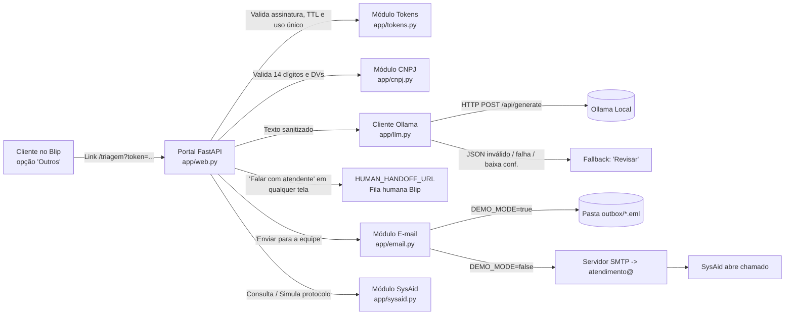

# Arquitetura — Portal de Triagem de Chamados com IA Local

## 1. Visão Geral e Fluxo (Mermaid)

---

## 2. Dados e Política de Retenção

- **Entrada via URL**: apenas `token` assinado (`itsdangerous.URLSafeTimedSerializer`) contendo `cid` (identificador da conversa/telefone) e `jti` (UUID único). Nenhum dado pessoal trafega em texto claro na URL.
- **Entrada via formulário**: `nome_completo`, `cnpj`, `email`, `descricao`.
- **Saída**: e-mail estruturado com código `TRI-AAAAMMDD-XXXX`, CNPJ no assunto e resumo + dados + mensagem original no corpo.
- **Retenção**: nenhum dado pessoal é gravado em banco de dados pelo portal. O estado de `jti` usado expira em memória logo após `TOKEN_TTL_SECONDS + 60s`.

---

## 3. Dependências e Licenças

| Pacote | Finalidade | Licença |
| :--- | :--- | :--- |
| `fastapi` | Framework web e rotas HTTP | MIT |
| `uvicorn` | Servidor ASGI | BSD-3-Clause |
| `jinja2` | Renderização HTML server-side | BSD-3-Clause |
| `pydantic` / `pydantic-settings` | Validação de dados e configuração | MIT |
| `httpx` | Cliente HTTP assíncrono para Ollama | BSD-3-Clause |
| `itsdangerous` | Assinatura e expiração de tokens | BSD-3-Clause |
| `python-multipart` | Parse de formulários HTML | Apache-2.0 |
| `pytest` | Suíte de testes automatizados | MIT |
| `Ollama` + modelo local (ex.: Llama 3.1) | Inferência local | MIT (Ollama) / Licença do modelo escolhido |

Todas as dependências da aplicação usam licenças permissivas (MIT / BSD / Apache-2.0). Ao trocar o modelo no Ollama, verificar a licença específica do peso escolhido.

---

## 4. Custos

- **Software e inferência**: custo zero de API externa (inferência 100% local via Ollama).
- **Infraestrutura**: requer servidor/VM com CPU ou GPU compatível com o modelo escolhido (ex.: 8 GB–16 GB de RAM para modelos 7B/8B quantizados) e acesso ao servidor SMTP corporativo.

---

## 5. Segurança

- **Tokens**: assinados com HMAC (`itsdangerous`), TTL curto (`TOKEN_TTL_SECONDS=900`), uso único via registro de `jti`.
- **Proteção contra injeção de prompt**: a mensagem do cliente é sanitizada (remoção de caracteres de controle e neutralização das tags delimitadoras) e encapsulada em `<mensagem_cliente>...</mensagem_cliente>`, com instrução explícita no prompt para tratá-la apenas como dado.
- **Validação de entrada**: Pydantic + validação determinística de CNPJ (`app/cnpj.py`), nunca delegada ao LLM.
- **Rate limit**: janela deslizante em memória por IP e por prefixo de token (`RATE_LIMIT_REQUESTS` / `RATE_LIMIT_WINDOW_SECONDS`).
- **Logs**: mascaramento obrigatório de CNPJ, e-mail e telefone (`mask_cnpj`, `mask_email`, `mask_phone`).
- **Segredos**: zero segredos no código; `.env` excluído no `.gitignore`.

---

## 6. Testes

- Unitários: validação de CNPJ (`tests/test_cnpj.py`), tokens (`tests/test_tokens.py`), fallback/parsing do LLM (`tests/test_llm.py`), geração de e-mail e mascaramento (`tests/test_email.py`).
- Integração: fluxo completo em modo demonstração (`tests/test_flow.py`) usando `TestClient` e mock do LLM.
- Avaliação de qualidade: `scripts/avaliar_modelo.py` sobre 40 chamados sintéticos em `data/chamados_sinteticos.json`.

---

## 7. Limitações (Honestas)

1. **Precisão do modelo local**: modelos locais menores (7B/8B) são menos precisos que modelos de fronteira em nuvem, especialmente em mensagens muito curtas, irônicas ou ambíguas. Por isso existe o fallback obrigatório para **`Revisar`**.
2. **Dependência do Blip**: o fluxo depende de o bot do Blip gerar/abrir o link `/triagem?token=...` quando o usuário seleciona "Outros".
3. **Protocolo do SysAid**: o número de protocolo do SysAid não existe antes do processamento do e-mail; no modo atual ele é simulado em demo ou obtido posteriormente por confirmação (e-mail de retorno ou API).
4. **A IA nunca fecha o chamado sozinha**: o modelo apenas sugere categoria, prioridade e resumo; o cliente sempre confirma o envio (ou pede atendente humano), e a equipe humana trata o chamado no SysAid.

---

## 8. Monitoramento e Implantação

- **Healthcheck**: `GET /health` retorna `{"status": "ok", "demo_mode": ...}`.
- **Métricas recomendadas via logs**: taxa de fallback para `"Revisar"`, tempo de resposta do Ollama, taxa de cliques em `/atendente` e erros SMTP.
- **Implantação**: rodar atrás de proxy reverso HTTPS (Nginx/Caddy/Traefik) com `DEMO_MODE=false`, `SECRET_KEY` forte e variáveis SMTP configuradas.

---

## 9. Rollback e Continuidade

- **Rollback imediato**: desativar o envio do link `/triagem?token=...` no fluxo "Outros" do bot do Blip e direcionar diretamente para a fila humana ou fluxo manual anterior. Nenhuma alteração estrutural no SysAid é necessária.
- **Continuidade — Troca de modelo**: alterar apenas `MODEL_NAME` (e opcionalmente `OLLAMA_URL`) no `.env`, sem alterar código.
- **Continuidade — Integração direta com Blip/SysAid**:
  - Para receber dados ou devolver status via webhook/API do Blip, adicionar cliente HTTP em novo módulo mantendo `app/llm.py` e `app/cnpj.py` intactos.
  - Para confirmar o protocolo real do SysAid, implementar `EmailConfirmationSysAidProvider` (leitura IMAP/webhook) ou `ApiSysAidProvider` (REST) em `app/sysaid.py`.
